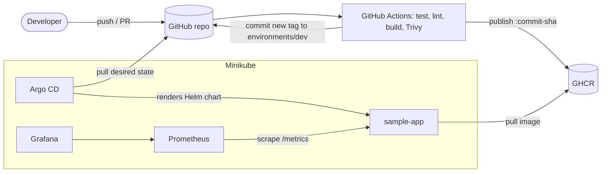

# GitOps Kubernetes Platform

A small but complete GitOps platform for a local Kubernetes cluster (Minikube). Git is the single source of truth:
**GitHub Actions** tests, scans and publishes a container image, records the new immutable image tag in Git, and
**Argo CD** reconciles the cluster with what Git says. **Prometheus and Grafana** (kube-prometheus-stack) monitor it.

Built as a Cloud & DevOps engineering portfolio project. The step-by-step explanations are written for beginners.

> Status honesty: the application, Helm chart and YAML checks were executed and passed (see
> [What is tested](#what-is-tested-and-what-is-not)). Docker build, Trivy, Minikube, Argo CD, monitoring and the GitHub Actions run
> could **not** be executed when this repository was generated: you run them, then add your own screenshots.

## Architecture



CI and CD are separate on purpose: GitHub Actions never holds cluster credentials and never deploys; Argo CD runs inside
the cluster and pulls from Git. Details: [docs/architecture.md](docs/architecture.md).

## Technology stack

| Area | Tool | Version |
|---|---|---|
| Local cluster | Minikube (Docker driver) | latest stable |
| Container | Docker, `python:3.12-slim`, non-root UID 10001 | - |
| GitOps CD | Argo CD | v3.5.6 |
| Packaging | Helm chart `sample-app` | chart 0.1.0, Helm 3.19.0 (also linted with 4.3.1) |
| CI | GitHub Actions (actions pinned by commit SHA) | - |
| Image scan | Trivy (`aquasecurity/trivy-action`) | v0.36.0 |
| Validation | yamllint, `helm lint`, kubeconform | 1.38.0 / - / 0.6.7 |
| Monitoring | kube-prometheus-stack (Prometheus, Grafana) | chart 92.11.0 |
| Application | Python 3.12, Flask 3.0.3, gunicorn 23.0.0, prometheus-client 0.21.0 | - |

## Repository structure

```
gitops-kubernetes-platform/
├── README.md  LICENSE  Makefile  .gitignore  .yamllint.yaml
├── .github/
│   ├── workflows/ci.yaml            # CI pipeline + Git tag update
│   └── dependabot.yml               # keeps actions, pip, base image current
├── app/
│   ├── src/app.py                   # Flask app: /, /health, /version, /metrics
│   ├── tests/test_app.py            # unit tests (pytest)
│   ├── Dockerfile  .dockerignore  pytest.ini
│   └── requirements.txt  requirements-dev.txt
├── helm/sample-app/
│   ├── Chart.yaml  values.yaml  values-dev.yaml  .helmignore
│   └── templates/                   # deployment, service, ingress, configmap, serviceaccount, hpa,
│                                    # servicemonitor, _helpers.tpl, NOTES.txt
├── environments/dev/values.yaml     # image repository + tag (tag edited by CI)
├── argocd/
│   ├── project.yaml                 # AppProject (guard rails + read-only role)
│   └── application.yaml             # Application (what/where to deploy)
├── monitoring/
│   ├── README.md                    # how to install and verify
│   └── values.yaml                  # kube-prometheus-stack settings
├── scripts/
│   ├── setup-minikube.sh  install-argocd.sh  deploy-local.sh
│   └── configure-repo.sh  install-monitoring.sh     # added
└── docs/
    ├── architecture.md  installation.md  deployment-workflow.md  troubleshooting.md
    └── screenshots/README.md        # what to capture, no fake images
```

Changes from the requested layout (all intentional): added `servicemonitor.yaml` (so app metrics are really scraped),
`monitoring/values.yaml` and `scripts/install-monitoring.sh` (reproducible monitoring install), `scripts/configure-repo.sh`
(replaces the `YOUR_GITHUB_USERNAME` placeholder), `.yamllint.yaml`, `dependabot.yml`, and `NOTES.txt`.
`values-dev.yaml` holds dev behaviour; `environments/dev/values.yaml` is kept for the one thing CI changes (image tag).

## Prerequisites

Docker, Minikube, kubectl, Helm, Git, make, Python 3, yamllint, kubeconform, and a GitHub account. Windows users use
WSL2 Ubuntu. Exact commands for PowerShell and Ubuntu: [docs/installation.md](docs/installation.md).

## Quick start

```bash
git clone https://github.com/<you>/gitops-kubernetes-platform.git && cd gitops-kubernetes-platform
./scripts/configure-repo.sh <you>          # replace placeholders, then commit and push to GitHub (branch main)
make check                                 # tests + lint + validation, no cluster needed
make cluster-up                            # Minikube + addons
make monitoring-install                    # Prometheus + Grafana
make argocd-install                        # Argo CD
make deploy-gitops                         # Argo CD now deploys from GitHub
kubectl -n argocd get applications         # expected: sample-app-dev  Synced  Healthy
make pf-app                                # then: curl localhost:8080/health  ->  {"status":"ok"}
```
The first push to `main` triggers CI, which publishes the first image and commits its tag; Argo CD then deploys it.
Until then the Pods show `ImagePullBackOff` because the placeholder tag `initial` does not exist. This is expected.

## GitOps workflow

1. Change code, open a pull request: CI runs every check, publishes nothing.
2. Merge to `main`: CI re-runs checks, builds, scans with Trivy, pushes `ghcr.io/<owner>/gitops-sample-app:<sha12>`.
3. The `update-gitops` job commits the new tag to `environments/dev/values.yaml`.
4. Argo CD detects the commit, renders `helm/sample-app` with the dev values and syncs.
5. Kubernetes rolls out gradually (`maxSurge: 1`, `maxUnavailable: 0`, readiness probe on `/health`).

Full explanation, rollback and token/secret setup: [docs/deployment-workflow.md](docs/deployment-workflow.md).

## CI pipeline

| Job | Runs on | What it does |
|---|---|---|
| `test` | PR + main | pytest |
| `validate` | PR + main | yamllint, `helm lint`, `helm template` + kubeconform (Kubernetes 1.31.0 schemas + CRD schemas for ServiceMonitor, Argo CD) |
| `build-scan` | PR + main | Docker build (not pushed), Trivy fails on fixable HIGH/CRITICAL |
| `publish` | main only, after all of the above | push image tagged with the commit SHA to GHCR (`packages: write`) |
| `update-gitops` | main only, after publish | commit the tag to Git (`contents: write`) |

Workflow-level permissions are `contents: read`. Credentials: only the built-in `GITHUB_TOKEN`, no stored secret.

## Monitoring

`make monitoring-install`, then `make pf-grafana` / `make pf-prometheus`. The application exposes real metrics
(`sample_app_http_requests_total`, `sample_app_http_request_duration_seconds`) scraped through a ServiceMonitor.
Dashboards, queries and verification: [monitoring/README.md](monitoring/README.md).

## Security considerations

- Container: non-root UID 10001, read-only root filesystem, all capabilities dropped, no privilege escalation, `RuntimeDefault` seccomp, slim base image, multi-stage build.
- Kubernetes: resource requests/limits, liveness and readiness probes, ServiceAccount token not mounted.
- Supply chain: Trivy gate, immutable SHA tags, actions pinned by commit SHA, kubeconform binary checksum verified, Dependabot.
- Argo CD: dedicated AppProject limiting repository, namespace and resource kinds, a read-only project role, no cluster-admin credentials outside the cluster.
- No secrets in Git; Grafana's admin password is generated by the chart.
- Not covered here (needs more than Minikube): NetworkPolicies enforcement, SSO, secret manager, image signing, admission policies. See the comparison in [docs/architecture.md](docs/architecture.md#minikube-versus-a-production-cluster).

## Troubleshooting

See [docs/troubleshooting.md](docs/troubleshooting.md).

## Cleanup

```bash
kubectl delete -f argocd/application.yaml
helm uninstall kube-prometheus-stack -n monitoring
make cluster-down        # deletes the Minikube cluster
```

## Screenshots

None are committed on purpose. After you run the project, capture your own by following
[docs/screenshots/README.md](docs/screenshots/README.md), then embed them here, for example
``.

## What is tested and what is not

Executed while generating this repository (Linux sandbox, results as observed):

| Check | Result |
|---|---|
| `pytest` (8 tests) | 8 passed |
| App started with gunicorn, `curl` on `/`, `/health`, `/version`, `/metrics` | correct responses, counters incremented |
| `yamllint` on the repository | no findings |
| `helm lint` (default and dev values), Helm 3.19.0 and 4.3.1 | 0 failed (only the "icon recommended" notice) |
| `helm template` + `kubeconform -strict` (K8s 1.31.0) | default 4/4 valid, dev 7/7 valid (includes ServiceMonitor via CRD schema), Argo CD manifests 2/2 valid |
| `bash -n` on all scripts; `configure-repo.sh` on a copy; the CI `sed` tag update on a copy | pass |

**Not executed** (you must verify; expected results are given in the docs):

| Item | Why |
|---|---|
| `docker build` of the Dockerfile and running the container | no Docker in the sandbox |
| Trivy scan result | no Docker/Trivy; a finding may require bumping the base image |
| Execution of `setup-minikube.sh`, `install-argocd.sh`, `install-monitoring.sh`, `deploy-local.sh` | no cluster; only syntax checked |
| Argo CD sync, the `../../environments/dev/values.yaml` value-file path, self-heal, rolling update, HPA scaling | needs a running cluster |
| Prometheus scraping the ServiceMonitor, Grafana dashboards | needs a running cluster |
| The GitHub Actions workflow itself, GHCR push, bot commit to `main` | needs GitHub; the action versions were looked up on their repositories but never run |
| Ingress through `minikube tunnel` | needs a cluster |

## License

MIT, see [LICENSE](LICENSE).
