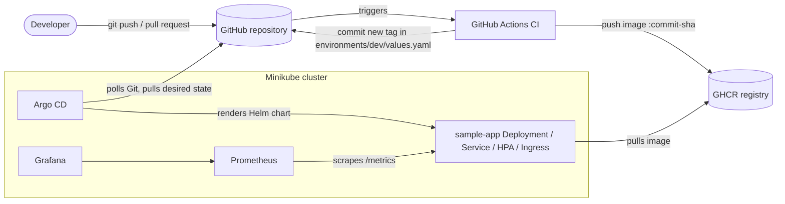

# Architecture

## Big picture

Two separate responsibilities:

| Concern | Tool | What it does | What it must NOT do |
|---|---|---|---|
| CI (build, test, publish) | GitHub Actions | Tests, validates, builds, scans, pushes the image, writes the new tag into Git | Never talks to the cluster, holds no kubeconfig |
| CD (deploy) | Argo CD, inside the cluster | Pulls the repository, renders the chart, makes the cluster match Git | Never builds images |

The cluster credentials stay inside the cluster. GitHub only needs write access to the repository and the registry.

## How the files interact

| File | Role |
|---|---|
| `app/src/app.py` | The web application (`/`, `/health`, `/version`, `/metrics`) |
| `app/Dockerfile` | Builds the image; runs as UID 10001; listens on port 8080 |
| `helm/sample-app/` | Chart that turns the image into Kubernetes objects |
| `helm/sample-app/values.yaml` | Safe defaults for every setting |
| `helm/sample-app/values-dev.yaml` | Dev settings: Ingress, HPA, ServiceMonitor on |
| `environments/dev/values.yaml` | Image repository and tag, the only file CI edits |
| `argocd/project.yaml` | AppProject: allowed repository, namespace, resource kinds, read-only role |
| `argocd/application.yaml` | Points Argo CD to `helm/sample-app` with the three values files above (last one wins) |
| `.github/workflows/ci.yaml` | Pipeline described in [deployment-workflow.md](deployment-workflow.md) |
| `monitoring/values.yaml` | Settings for kube-prometheus-stack |

Naming conventions used everywhere: namespace `sample-app-dev` (application), `argocd`, `monitoring`;
Helm release `sample-app`; Service `sample-app` on port 80 forwarding to container port 8080 (`http`);
image `gitops-sample-app`; Minikube profile `gitops`; Argo CD project `sample-platform`; Application `sample-app-dev`.

## Kubernetes objects created by the chart

Deployment (rolling update, probes, resources, security context), Service, ServiceAccount (token not mounted),
ConfigMap (environment variables; its checksum is an annotation so a config change restarts Pods),
optional Ingress, optional HorizontalPodAutoscaler (`autoscaling/v2`), optional ServiceMonitor.

## Versions selected

| Component | Version | Notes |
|---|---|---|
| Python / Flask / gunicorn / prometheus-client | 3.12 / 3.0.3 / 23.0.0 / 0.21.0 | pinned in `app/requirements.txt` |
| Helm | 3.19.0 (CI); chart also linted with 4.3.1 | chart `apiVersion: v2` works with both |
| Argo CD | v3.5.6 | value of the upstream `stable` tag when this project was generated |
| kube-prometheus-stack | 92.11.0 | pinned in `scripts/install-monitoring.sh` |
| kubeconform | v0.6.7 | download is checksum-verified in CI |
| Kubernetes schema for validation | 1.31.0 | Minikube uses its own `stable` version by default |
| GitHub Actions | pinned by commit SHA | version in a trailing comment; Dependabot proposes updates |

Re-check these versions when you publish; they move quickly.

## Minikube versus a production cluster

| Topic | Minikube (this project) | Production |
|---|---|---|
| Nodes | One node: no real high availability | Several nodes across zones |
| Storage | Ephemeral, no backup | Persistent volumes, backups |
| Ingress / network | Addon, reached by port-forward or tunnel; default CNI does not enforce NetworkPolicy | Cloud load balancer, TLS, NetworkPolicies |
| Secrets | None needed here | External secret manager (e.g. External Secrets, Sealed Secrets, Vault) |
| Argo CD access | Admin account and port-forward | SSO, RBAC per team, repository credentials for private repos |
| Registry | Public GHCR package | Private registry with pull secrets, image signing |
| Monitoring | 24 h retention, no Alertmanager | Long-term storage, alerting, on-call |
| Environments | `dev` only | Separate clusters or namespaces for staging/prod, with promotion by pull request |
| Autoscaling | HPA only scales Pods inside one small node | Cluster autoscaler adds nodes |
